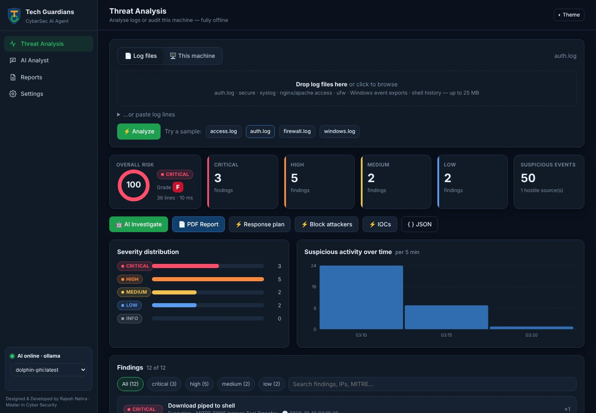

# 🛡️ CyberSec AI Agent — offline SIEM log analysis platform

A **portable, offline cybersecurity analysis platform** with a professional web UI. Upload log
exports from your SIEM (CSV, JSON, JSON Lines, Windows Event XML, syslog, CEF/LEEF, firewall, VPN,
IDS, proxy, DNS, EDR, web) and it will:

- detect attacks with about 70 documented rules
- correlate events into incidents and reconstruct the attack timeline
- score user behaviour (UEBA)
- apply your **trusted networks, ISP addresses and assets** as context
- let a **local, uncensored AI model** investigate the evidence
- produce a **branded 15-section A4 PDF report**

Nothing leaves your machine. The one exception is the optional reputation look-up, which sends
only public indicators (IPs, domains, URLs, hashes, CVE IDs) to the threat-intelligence sources you enable, and only when you ask.

📘 **Full guide: [docs/SIEM-ANALYSIS-GUIDE.md](docs/SIEM-ANALYSIS-GUIDE.md)** · 🐧 CPU-only Linux setup: [docs/LINUX-GUIDE.md](docs/LINUX-GUIDE.md)



📑 Example report: [docs/sample-report.pdf](docs/sample-report.pdf), generated from the seven-source sample incident in `samples/siem/`.

| ✅ | Feature |
|---|---|
| 🖥️ | Runs a local, uncensored AI (Ollama, LM Studio, llama.cpp, KoboldCpp, Jan…) |
| 🦙 | Works with any open-source model: Dolphin, Llama, Qwen, Mistral, Phi… |
| ⚙️ | Talks to the local AI's API server (Ollama or OpenAI-compatible) |
| 🐍 | **Pure Python standard library**: nothing to build. Only the PDF export uses one optional library (`reportlab`) |
| 📄 | Analyzes Linux auth/syslog, Apache/Nginx, UFW/iptables, Windows events, shell history |
| 🛡️ | Detects ~30 attack patterns instantly (brute force, SQLi, Log4Shell, reverse shells, mimikatz…) mapped to MITRE ATT&CK |
| 🖥️ | **Live Linux host audit**: SSH, accounts, sudo, exposed services, firewall, kernel hardening, SUID, malware processes, cron backdoors, updates, plus the system's own logs |
| 🔎 | Attacker IP profiles, attack timeline, IOC extraction (IPs, URLs, domains, files, accounts) |
| ⚡ | **Instant local answers** without AI: response plan, firewall block commands (ufw/iptables/nftables/fail2ban/Windows), IOCs, explanations and fixes |
| 📥 | **SIEM ingestion**: streamed multi-file upload, automatic format and log-source detection, configurable field mapping, timestamp and time-zone normalisation, parse-failure reporting, evidence references to the original `file:line` |
| 🧭 | **Action taken and attack flow**: every event shows what the firewall, IDS, VPN, server or machine did (allowed, blocked, served HTTP 200, executed…), and every incident gets an attack path and a step-by-step flow (source → firewall → server → URL/path or command → outcome) in the GUI and the PDF |
| 🔗 | **Correlation and incidents**: actor-based linking across sources, ATT&CK kill-chain ordering, an attack timeline with evidence IDs, and a SOAR checklist (recommendations only) |
| 👤 | **UEBA**: explainable per-account baselines (hours, sources, hosts, privileges, peers), with thin-history detection |
| 🏢 | **Trusted Networks & Assets**: CIDR/IP inventory with precedence, import/export with preview, and a change history. Trust is context and never suppresses a finding |
| 🎨 | **Branding**: app and organisation names, logo (validated PNG/JPEG), colours and report labels, all editable in the UI. Hide it from the web UI with `"ui_show_branding": false`, and lock the Branding page with `"ui_hide_branding_page": true` in `config.json` |
| 🗂️ | **History**: every analysis is stored with its original logs (SHA-256), so you can open it again, re-analyse it with the current rules, download the logs or delete it. Retention by age or size |
| 🌐 | **Threat intelligence**: AlienVault OTX, AbuseIPDB, VirusTotal, abuse.ch URLhaus / ThreatFox / MalwareBazaar, PhishTank and CVE details from cve.circl.lu, for IPs, domains, URLs, file hashes and CVEs. Optional and only on request; internal and your own addresses are never sent |
| 📡 | **Live analysis window**: your SIEM forwards suspicious logs (HTTP webhook with token, or syslog UDP/TCP) and they are analysed continuously, with live alerts, action taken, a flagged event stream, incidents and snapshots to the History |
| 🔬 | **Forensics page**: one tab per attack type (type of attack, actions taken by devices, recommendations, further suggestions, ordered forensic steps, read-only collection commands) and a **visual attack diagram** per incident: attacker → gateway → server → URL/path → C2/exfiltration, coloured by outcome. Also in the PDF |
| 🟢 | **Trusted always green**: your networks, ISP addresses and assets are never shown as malicious, never listed as IOCs and never block targets. Their findings are still reported |
| 🧠 | **Learns from your data**: your true/false-positive verdicts, confirmed and reputation-malicious indicators (a local IoC feed) and earlier sightings feed into every new analysis and the AI's case file. Reviewable and removable; nothing is ever hidden |
| 📑 | **15-section A4 PDF report**: finding cards that paginate correctly, timeline, UEBA, trust context, ATT&CK, threat intelligence, risk, false positives, remediation, evidence appendix, limitations. Markdown export too |
| 💬 | Chat with the agent: exploits, hardening, Sigma/Splunk rules, attacker intent, CTFs |

**Why it's fast:** the rule engine scans about 30,000 log lines per second and explains
every finding from an offline knowledge base, all without AI. The AI only receives a
compact summary (1–2 KB), the model stays loaded in RAM, repeated questions come from a
cache, and "thinking" models answer directly. Even CPU-only machines reply quickly.

---

## 🚀 Quick start (3 steps)

**1. Install a local AI server**: [Ollama](https://ollama.com/download) (recommended)

```bash
# Linux
curl -fsSL https://ollama.com/install.sh | sh
# macOS / Windows: download the installer from https://ollama.com/download
```

**2. Download an uncensored model** (one time)

```bash
ollama pull dolphin-phi        # 1.6 GB, fastest, runs on any laptop CPU
```

**3. Start the agent**

```bash
git clone https://github.com/nehraeduhub/CyberSecuirty.git
cd CyberSecuirty/ai-agent
./start.sh          # Linux / macOS
start.bat           # Windows (double-click)
# or simply:  python agent.py
```

Your browser opens **http://127.0.0.1:8787**. Click a sample log (for example `auth.log`),
press **⚡ Analyze**, then **🤖 AI Investigate**.

> The start scripts launch Ollama for you and download `dolphin-phi` on first run if
> you have no models. Use a different model with `AGENT_MODEL=dolphin3 ./start.sh`.

Only **Python 3.8+** is required. It's preinstalled on Linux and macOS; on Windows get it
from [python.org](https://www.python.org/downloads/) and tick "Add to PATH".

For **PDF reports**, install one library: `sudo apt install python3-reportlab` (Ubuntu/Debian)
or `pip install reportlab`. Everything else works without it.

---

## 🦙 Recommended models

| Model | Size | RAM | Notes |
|---|---|---|---|
| `dolphin-phi` | 2.7B | ~3 GB | Uncensored, **fastest**, good on CPU-only machines |
| `dolphin-mistral` | 7B | ~6 GB | Uncensored, better reasoning |
| `dolphin3` | 8B | ~6 GB | Uncensored (Llama 3.1 based), **best quality/speed balance** |
| `llama2-uncensored` | 7B | ~6 GB | Classic uncensored model |
| `qwen2.5:3b` / `llama3.2:3b` | 3B | ~3 GB | Not uncensored, but fast and strong at analysis |
| `qwen3:30b-a3b` | 30B MoE (3B active) | ~19 GB | Best quality at high speed on CPU machines with 32 GB+ RAM |

Switch models any time from the drop-down in the sidebar. Everything you've pulled
with `ollama pull` appears there automatically.

## 🔌 Using LM Studio, llama.cpp, KoboldCpp, Jan, vLLM…

Any OpenAI-compatible server works. Open **⚙️ Settings** in the UI → Provider
**OpenAI-compatible**, then set the URL:

| Server | URL |
|---|---|
| LM Studio | `http://127.0.0.1:1234/v1` (enable "Local Server") |
| llama.cpp `llama-server` | `http://127.0.0.1:8080/v1` |
| KoboldCpp | `http://127.0.0.1:5001/v1` |
| Jan | `http://127.0.0.1:1337/v1` |

Settings are saved to `config.json`. You can also use environment variables:
`AGENT_PROVIDER`, `AGENT_BASE_URL`, `AGENT_MODEL`, `AGENT_API_KEY`, `AGENT_HOST`, `AGENT_PORT`, `AGENT_TOKEN`.

---

## 💻 Command-line mode

```bash
python agent.py scan export.csv firewall.jsonl dns.json --pdf report.pdf   # SIEM exports, several at once
python agent.py scan /var/log/auth.log                    # instant rule-based scan
python agent.py scan access.log --ai --pdf incident.pdf   # + AI assessment + PDF report
python agent.py scan access.log --json > out.json
sudo python agent.py audit --pdf audit.pdf --client "ACME" --assessor "SOC team"   # Linux host audit
python agent.py set-password                              # web login with username + password instead of the token
python agent.py make-cert --port 443                      # HTTPS on port 443 with a self-signed certificate
python agent.py --port 9000 --model dolphin3 --no-browser
python scripts/benchmark.py                               # measure each model's speed
```

PDF branding (name, tagline, author line, colours) can be changed under `"report"` in
`config.json`. See `BRAND` in [`report_pdf.py`](report_pdf.py) for the keys.

## 🔍 What it detects

| Category | Examples |
|---|---|
| Brute force | SSH/Windows password guessing, **successful login after brute force** (likely compromise), invalid users |
| Web attacks | SQL injection, XSS, path traversal, command injection, Log4Shell, scanners (sqlmap, nikto, gobuster…), `.env`/`.git` probes, directory enumeration |
| Network | Port scans from firewall logs |
| Post-exploitation | `curl \| bash`, reverse shells, encoded PowerShell, mimikatz/LSASS dumping, crypto miners, binaries in `/tmp` |
| Persistence & privilege | New accounts, admin group changes, cron/scheduled tasks, `authorized_keys`, unauthorized sudo |
| Anti-forensics | Log deletion, `history -c`, Windows audit log cleared (1102) |

Rules live in [`detector.py`](detector.py) as plain regexes, so it's easy to add your own.

## 🎒 Make it fully portable (USB stick)

1. Copy the `ai-agent` folder to the USB drive.
2. Store the models on the drive too: set `OLLAMA_MODELS=/path/to/usb/models`
   (Windows: `set OLLAMA_MODELS=E:\models`) before `ollama serve` / `ollama pull`.
3. On any machine with Python and Ollama, run `start.sh` / `start.bat` from the drive.

## 🔒 Security notes

- The agent listens on `127.0.0.1` only by default, so other machines can't reach it.
- **To open it on the host IP:** set `"host": "0.0.0.0"` (or the server's IP) in `config.json`, or run
  `python agent.py --host 0.0.0.0`. Other computers then need the **access token** to sign in.
  It is generated on first start, printed in the terminal, and stored in `config.json`.
  **To sign in with a username and password instead**, run `python3 agent.py set-password` and restart
  (only a salted hash is stored; `python3 agent.py remove-password` goes back to the token). Use
  this only on a trusted LAN/VPN, or turn on **HTTPS**: `python agent.py make-cert --port 443` (or your own
  certificate via `"tls_cert"` / `"tls_key"`). Details: [docs/LINUX-GUIDE.md](docs/LINUX-GUIDE.md).
- Requests from other websites are blocked (Host header + JSON content-type checks), so a
  malicious page can't drive your agent or change its settings.
- Log content is always HTML-escaped in the UI, so attacker-controlled log lines can't
  run scripts in your browser.
- Use the agent only on systems you own or are authorised to assess.

## 🧪 Tests

```bash
python -m unittest discover -s tests -v
```

## 📁 Files

```
ai-agent/
├── agent.py               # web server + API, local AI client (cache, warm-up), CLI
├── parsers.py             # SIEM format detection, streaming readers, field mapping, timestamps
├── engine.py              # structured rules, UEBA, statistics, threat intel, forensics
├── rules.py               # detection rule catalogue (IDs, severity, confidence, ATT&CK, FP guidance)
├── forensics.py           # forensic view per attack type (steps, read-only commands, suggestions)
├── live.py                # live analysis of SIEM-forwarded logs (HTTP ingest, syslog, rolling window, alerts)
├── history.py             # stored analyses + original logs (open, re-analyse, download, delete, retention)
├── reputation.py          # AbuseIPDB / VirusTotal look-ups (opt-in, public indicators only, cached)
├── memory.py              # learning: analyst verdicts, learned IoC feed, sightings across analyses
├── pipeline.py            # upload-to-report pipeline: correlation, risk, evidence register, SOAR
├── flow.py                # action taken per event (firewall/server/machine) and incident attack flow
├── investigator.py        # AI investigation agent: case file, deterministic investigation, answer checks
├── trust.py               # Trusted Networks & Assets (validation, precedence, import/export, history)
├── branding.py            # branding settings and safe logo handling
├── config_store.py        # atomic config files + audit trail
├── config/examples/       # example trusted assets, branding, field mappings, rule overrides
├── detector.py            # log rule engine, correlation, timeline, attacker profiles, IOCs
├── knowledge.py           # offline knowledge base + instant answers (fixes, block commands)
├── host_audit.py          # live Linux host security audit
├── report_pdf.py          # Tech Guardians branded PDF report (optional: reportlab)
├── static/index.html      # the web UI (single file, no build step)
├── static/live.html       # the separate Live analysis window
├── samples/               # example attack logs; samples/siem/ = seven-source SIEM incident
├── scripts/setup-linux.sh # one-command, speed-tuned Linux install
├── scripts/benchmark.py   # tokens/second per model on this machine
├── docs/LINUX-GUIDE.md    # guide for CPU-only Linux servers
├── tests/                 # unit tests
├── start.sh               # Linux/macOS launcher
└── start.bat              # Windows launcher
```
