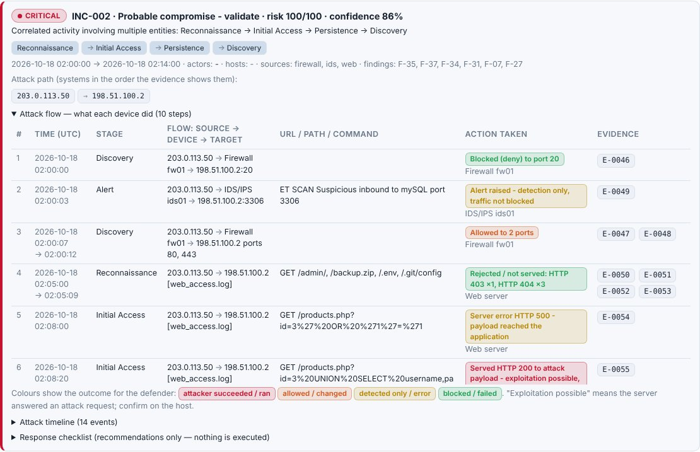

# SIEM Log Analysis Platform — Guide

The agent analyses logs exported from your SIEM completely offline. It detects attack patterns,
correlates events into incidents, scores behaviour (UEBA), applies your trusted network and
asset inventory, lets a local AI model investigate the results, and produces a branded A4 PDF report.

```
upload ─► parse & normalise ─► detect (rules, UEBA, statistics, threat intel, forensics)
       ─► trust context ─► correlate into incidents ─► explainable risk ─► evidence register
       ─► AI investigation (local, optional) ─► 15-section PDF / Markdown report
```

Everything works without an AI model. The model only reviews the engine's structured results.

---

## 1. Run it

```bash
cd ~/CyberSecuirty/ai-agent
git pull
sudo apt install -y python3-reportlab     # once, for PDF reports
python3 agent.py                          # or: sudo systemctl restart cybersec-agent
```

Open the web UI and choose **Threat Analysis → Log files**. You can drop one file or many
exports at once; the engine correlates across all of them. Click **SIEM dataset (6 sources)**
to see a complete multi-source incident first.

From the terminal:

```bash
python3 agent.py scan export1.csv firewall.jsonl dns.json --pdf report.pdf --client "ACME"
python3 agent.py scan samples/siem/*.{csv,jsonl,json,cef,log,xml} \
        --trust samples/siem/trusted_assets.demo.json --ioc samples/siem/ioc_feed.csv --no-learn
python3 agent.py scan logs.csv --ai          # adds the local AI investigation
```

## 2. Supported log formats

| Format | Examples | Notes |
|---|---|---|
| CSV / TSV | Splunk, QRadar, Sentinel, Elastic exports; Windows Event Viewer CSV | Delimiter auto-detected; columns mapped automatically |
| JSON array / object | Elasticsearch/OpenSearch `_source` exports, API dumps | Streamed, even for very large arrays; nested fields flattened (`source.ip`) |
| JSON Lines | Firewall, proxy, EDR, cloud logs | One event per line |
| Windows Event XML | Event Viewer → *Save as XML* | `.evtx` binary is not supported: export as XML or CSV |
| Syslog (RFC 3164 / 5424) | Linux auth.log, secure, VPN, network devices | |
| CEF / LEEF | IDS/IPS (Suricata, Snort), many security appliances | |
| key=value | Fortinet, Palo Alto, VPN gateways, iptables/UFW | |
| Web access logs | Apache / Nginx combined | |
| Plain text | Anything else | IPs, users and keywords are still extracted |

`.gz` files are decompressed on the fly. Files are uploaded in a stream, written to
`data/uploads/` with owner-only permissions, and deleted after analysis (`keep_uploads` in
`config.json` keeps them).

For every file the report and UI show:
- the detected format and probable log source
- the column-to-field mapping
- field coverage
- timestamp formats and time zones
- events without a timestamp
- parse failures, with line numbers

**Your SIEM uses different field names?** Copy `config/examples/field_mappings.example.json` to
`config/field_mappings.json` and add aliases. No code change is needed.

**Logs without a time zone** are treated as UTC. Change this in **Settings → Analysis**
(`tz_hours`) if your sources log in local time, for example `5.5` for IST.

## 3. Trusted Networks & Assets

Open **Trusted Networks** in the sidebar. The live file is `config/trusted_assets.json`; it's
created from a disabled example on first use and is never overwritten by `git pull`.

| Section | Use it for |
|---|---|
| Internal / trusted networks | LAN, server, management and VPN client ranges (IPv4/IPv6 CIDR) |
| ISP-assigned public IPs | Your public addresses and ranges from your ISP |
| Servers, workstations & devices | Individual assets: DCs, DNS/DHCP, firewalls, routers, switches, VPN gateways, proxies, web servers, jump hosts, scanners, with hostname, owner, criticality, zone, allowed service ports |
| Known external services | Approved SaaS, update mirrors, partners (CIDR or domain) |
| Suspicious / blocked indicators | Addresses you consider bad; these always win |
| Approved service accounts | Service accounts, allowed hosts, and whether interactive logon is allowed |

- **Validation.** Every address is parsed with `ipaddress`.
  - A CIDR with host bits set (`192.168.1.5/16`) is refused rather than silently widened.
  - Ranges wider than /8 (IPv4) or /16 (IPv6) are refused, so a bad import can never trust the whole internet.
  - A malformed configuration file never crashes the application; its errors are shown on the page.
- **Precedence**, first match wins:
  1. Invalid address
  2. Suspicious indicator
  3. Exact asset IP
  4. The most specific ISP, external-service or network range (equal prefixes: ISP > external service > network)
  5. Loopback / link-local
  6. Other private (RFC 1918, ULA, CGNAT)
  7. Public address not in the inventory
- **Validity dates:** `valid_from`/`valid_until` are checked against the event's own timestamp.
- **Import/export:** CSV or JSON. **Preview** shows what would be added, updated or removed and which rows are rejected; only validated rows are applied.
- **Change history:** every add, edit, delete and import is recorded in `data/audit.log` with who made it, when, and the previous and new value. It's shown on the page.

### Trust is context, never an exemption

- Trusted classification **never lowers severity and never removes a finding**. A credential-dumping finding on a trusted workstation is still *critical*.
- Findings involving trusted assets carry a note saying so, and the risk score *adds* points for high-criticality assets.
- The only reduction is an explicit, explained contextual adjustment for an **approved scanner** (−15 risk, severity unchanged, never below 60% of the severity base). Its schedule and scope must still be validated.
- The AI agent receives the inventory with the rule "trusted is not safe" and the trust context of each finding.

## 4. Branding & report configuration

Open **Branding** in the sidebar. The file is `config/branding.json`.

**Settings you can change:**
- application name and organisation name
- report title and subtitle
- address or department, analyst name and contact
- classification label, header and footer text, and confidentiality notice
- report version and filename prefix
- four brand colours

**Logo:** PNG or JPEG only, up to 2 MB and between 16 and 4,096 px per side.
- The upload is checked by its content (file signature and image header) and by fully decoding the image, never by its file name.
- SVG is refused, because SVG files can contain scripts.
- Logos are stored under new unique names in `assets/branding/`, so nothing is ever overwritten. Replacing a custom logo asks for confirmation.

**Where it applies:** the sidebar, browser title, login page, PDF cover, page headers and footers, and the Markdown export. There's no rebuild or restart.

## 5. Detection catalogue

Thresholds, severity, confidence and on/off can be tuned in `config/detection_rules.json`
(see `config/examples/detection_rules.example.json`). Each rule carries:
- false-positive guidance
- the telemetry needed to validate it
- evidence limitations
- an ATT&CK mapping

| Rule ID | Detection | Severity | Base confidence | Method | ATT&CK |
|---|---|---|---|---|---|
| TG-API-001 | API abuse / endpoint enumeration | medium | 65% | threshold | T1595.003 |
| TG-AUTH-001 | Brute-force authentication | high | 80% | threshold | T1110.001 |
| TG-AUTH-002 | Password spraying | high | 85% | threshold | T1110.003 |
| TG-AUTH-003 | Account enumeration | medium | 75% | threshold | T1087 |
| TG-AUTH-004 | Successful logon after repeated failures | critical | 80% | correlation | T1078, T1110 |
| TG-AUTH-005 | Account lockout | medium | 70% | signature | T1110 |
| TG-AUTH-006 | Remote Desktop logon from unapproved source | high | 70% | context | T1021.001, T1133 |
| TG-AUTH-007 | Service account used interactively | high | 85% | policy | T1078.002 |
| TG-AUTH-008 | Successful logon within 1 h of a brute-force burst | critical | 85% | correlation | T1078 |
| TG-C2-001 | Beaconing (regular outbound connections) | high | 75% | statistical | T1071, T1573 |
| TG-CRED-001 | Credential dumping tool or technique | critical | 90% | signature | T1003.001 |
| TG-CRED-002 | Credential dumping tool | critical | 90% | regex signature | T1003 |
| TG-DB-001 | Suspicious database export | high | 70% | signature | T1213, T1005 |
| TG-DEF-001 | Security control tampering | high | 80% | signature | T1562.001, T1562.004 |
| TG-DNS-001 | DNS tunnelling indicators | high | 75% | statistical | T1071.004, T1572 |
| TG-DNS-002 | Algorithmically generated domains (NXDOMAIN burst) | medium | 65% | statistical | T1568.002 |
| TG-EXE-001 | PowerShell download cradle or obfuscation | high | 85% | signature | T1059.001, T1105, T1027 |
| TG-EXE-002 | Living-off-the-land binary abuse | high | 75% | signature | T1218 |
| TG-EXE-003 | Process started from a user-writable location | medium | 60% | signature | T1036 |
| TG-EXE-004 | Web or Office process spawned a shell | high | 80% | signature | T1505.003, T1059 |
| TG-EXE-005 | Download piped to shell | critical | 85% | regex signature | T1105 |
| TG-EXE-006 | Reverse shell | critical | 90% | regex signature | T1059.004 |
| TG-EXE-007 | Encoded PowerShell command | high | 80% | regex signature | T1059.001 |
| TG-EXE-008 | Executable dropped in temp directory | high | 65% | regex signature | T1059 |
| TG-EXF-001 | Large outbound data transfer | high | 70% | statistical | T1048, T1041 |
| TG-EXF-002 | Password-protected archive created | high | 70% | signature | T1560.001 |
| TG-FOR-001 | Audit policy changed | high | 80% | signature | T1562.002 |
| TG-FOR-002 | Logging interruption | high | 70% | signature | T1562.002, T1070 |
| TG-FOR-003 | Log collection gap | low | 50% | statistical | - |
| TG-FOR-004 | Timestamp inconsistencies | low | 60% | integrity | - |
| TG-FOR-005 | Security log cleared (Windows) | critical | 90% | regex signature | T1070.001 |
| TG-FOR-006 | Log tampering / anti-forensics | high | 80% | regex signature | T1070 |
| TG-IAM-001 | Privileged logon by an account outside the admin baseline | medium | 60% | UEBA | T1078.002 |
| TG-IAM-002 | User account created / privileged group change | medium | 70% | regex signature | T1136 |
| TG-IAM-003 | User added to privileged group (Windows) | high | 75% | regex signature | T1098 |
| TG-IDS-001 | IDS / EDR alert | medium | 70% | external alert | - |
| TG-LAT-001 | Lateral movement: one account to many hosts | high | 80% | threshold | T1021.002, T1078.002 |
| TG-LNX-001 | Critical Linux configuration change | medium | 65% | signature | T1098, T1556 |
| TG-LNX-002 | Failed SSH login | low | 40% | regex signature | T1110 |
| TG-LNX-003 | SSH login with invalid username | low | 60% | regex signature | T1110.001 |
| TG-LNX-004 | SSH brute-force attack (burst within 10 min) | high | 85% | correlation | T1110.001 |
| TG-LNX-005 | Successful root login over SSH | high | 70% | regex signature | T1078.003 |
| TG-LNX-006 | Failed / unauthorized sudo | medium | 60% | regex signature | T1548.003 |
| TG-MAL-001 | Ransomware preparation: recovery inhibition | critical | 90% | signature | T1490, T1486 |
| TG-MAL-002 | Cryptocurrency miner | high | 85% | regex signature | T1496 |
| TG-NET-001 | Port scan | medium | 80% | threshold | T1046, T1595 |
| TG-NET-002 | Repeated denied connections | medium | 65% | threshold | T1071 |
| TG-NET-003 | Possible denial of service | high | 60% | threshold | T1498 |
| TG-NET-004 | Cross-segment administrative traffic | medium | 55% | context | T1021.002, T1021.001 |
| TG-NET-005 | Inbound traffic to unapproved service on public server | medium | 60% | policy | T1190 |
| TG-NET-006 | Firewall / network device configuration change | medium | 70% | signature | T1562.004 |
| TG-NET-007 | Port scan in UFW/iptables logs | medium | 80% | correlation | T1046 |
| TG-PER-001 | New Windows service installed | high | 70% | signature | T1543.003 |
| TG-PER-002 | Scheduled task created | medium | 60% | signature | T1053.005 |
| TG-PER-003 | Persistence mechanism (cron/service/run key) | medium | 55% | regex signature | T1053 |
| TG-STAT-001 | Unusual event volume | low | 50% | statistical | - |
| TG-TI-001 | Threat-intelligence indicator match | high | 75% | threat intel | - |
| TG-TI-002 | Configured suspicious / blocked indicator observed | high | 80% | inventory | - |
| TG-UEBA-001 | Anomalous user behaviour | medium | 60% | UEBA | T1078 |
| TG-VPN-001 | VPN account used from multiple public sources | medium | 65% | correlation | T1133, T1078 |
| TG-WEB-001 | SQL injection attempt | high | 60% | regex signature | T1190 |
| TG-WEB-002 | Cross-site scripting (XSS) attempt | medium | 55% | regex signature | T1059.007 |
| TG-WEB-003 | Path traversal / sensitive file read | high | 65% | regex signature | T1083 |
| TG-WEB-004 | Log4Shell (JNDI) exploit attempt | critical | 75% | regex signature | T1190 |
| TG-WEB-005 | Command injection attempt | critical | 70% | regex signature | T1059 |
| TG-WEB-006 | Attack tool / scanner detected | medium | 80% | regex signature | T1595 |
| TG-WEB-007 | Probe for sensitive files | medium | 70% | regex signature | T1595.003 |
| TG-WEB-008 | Web directory enumeration (many 404s) | medium | 75% | correlation | T1595.003 |
| TG-WEB-009 | Web shell command execution | critical | 85% | regex signature | T1505.003 |
| TG-WIN-001 | Failed Windows logon | low | 40% | regex signature | T1110 |
| TG-WIN-002 | Windows logon brute force (burst within 10 min) | high | 85% | correlation | T1110.003 |

_70 rules._

**Correlation into incidents.** Findings are linked only through shared *actor* entities: the
account that logged on, the source of a scan or spray, the host where a command ran, and the
VPN-assigned IP that maps back to a user. Links also require the findings to fall within 2 hours
of each other. Time proximity alone never links findings.
- Victims of a spray and the targets of a scan don't merge unrelated activity.
- Entities present in more than half of all findings are treated as hubs and ignored for linking.
- Low-severity noise never drives correlation.

**UEBA.** Each account is compared with its own history (earlier events in the upload plus
`data/baselines.json` from earlier analyses) and with its peers. Every point of the 0–100 score
has a reason and an evidence reference. The checks are:
- unusual hour, new source IP (weighted lower inside a configured network), new host (higher for critical assets)
- failures followed by success, privileged activity without history
- service account used interactively, lateral movement, peer deviation, new account

Accounts with fewer than 10 logons or 3 days of history are marked *thin baseline*.
Baselines learn only from accounts that are not actors in an incident or high-severity finding.

**Scores.** These are separate fields:
- **severity:** the rule's severity
- **confidence:** the rule's base confidence, plus volume and cross-source corroboration
- **UEBA score**
- **risk:** severity base + confidence + correlation + attack stage + asset criticality + threat intel + behaviour + external source
- **asset trust**

Every risk factor is listed in the UI and the report.

**Threat intelligence.** Put CSV (`type,value,source,description`) or TXT (one indicator per
line) feeds in `config/ioc/`. IPs, VPN-assigned IPs, domains (including parent domains), URLs and
hashes are matched offline. `samples/siem/ioc_feed.csv` is an example feed with documentation addresses.

**Forensics.** Checks cover:
- log clearing (1102/104, `rm /var/log`) and audit policy changes
- logging service stops
- collection gaps (only for sources that normally log continuously)
- out-of-order and future timestamps, and mixed time zones

**SOAR.** Each incident gets an investigation checklist and phased response actions
(containment, eradication, recovery), with evidence IDs and a "needs authorisation" flag. **Nothing
is executed.** The platform never blocks IPs, disables accounts or changes systems.

## 6. Action taken and attack flow

For every event used as evidence, the tool records **what the reporting device did**, using only
fields present in the log. It shows this in an **Action taken** column in the GUI (incident
timeline, attack flow, finding details) and in the PDF (Section 4 finding cards, the Section 5
timeline, and the Section 13 evidence register).

| Source | Example actions |
|---|---|
| Firewall | `Allowed to port 443, 2.2 GB sent` · `Blocked (deny) to port 3389` · `Firewall policy changed` |
| IDS/IPS, EDR | `Alert raised - detection only, traffic not blocked` · `Blocked by sensor (drop)` |
| VPN | `Login rejected (bad_password)` · `Login accepted, VPN session opened, tunnel IP 192.0.2.200` |
| Web server | `Denied (HTTP 403)` · `Server error HTTP 500 - payload reached the application` · `Served HTTP 200 to attack payload - exploitation possible, verify` |
| Windows / Linux | `Logon failed (network)` · `Logon succeeded (RDP)` · `Process executed` · `User account created` · `Security audit log cleared` · `SSH login rejected` |
| DNS | `Resolved (NOERROR), TXT record` · `Name does not exist (NXDOMAIN)` · `Query refused` |

Each action is coloured by its outcome for the defender:
- **red:** the attacker's action succeeded or ran
- **orange:** allowed or changed
- **amber:** detected only, or a server error
- **green:** blocked or failed

An IDS "alert" is never reported as a block. An HTTP 200 to an attack payload is reported as
*exploitation possible*, never as a confirmed compromise: confirm it on the host.

Each correlated incident also gets:
- **Attack path:** the systems in the order the evidence shows them, e.g.
  `203.0.113.77 → vpn01 → 192.0.2.200 → DC01 → WS-BOB → 203.0.113.99 → FS01 → DB01 → HR01 → 203.0.113.150`
- **Attack flow:** numbered steps with these columns:
  - time
  - stage (ATT&CK tactic)
  - *source → device → target*
  - the URL, path, command or query
  - the action taken
  - the evidence IDs

  Repeated events are merged, e.g. 4 failed logons, 404 probing, or one account logging on to several servers.
  Firewall steps list the ports that were allowed or blocked. When the firewall log shows the attacker
  reaching a server on a web port, web-log steps name that server.
  Port-scan findings record which ports the firewall let through (`ports_allowed`).

Configured asset names from **Trusted Networks & Assets** are shown next to IPs, e.g.
`198.51.100.2 (WEB01)`. The AI case file includes the attack path and flow, and the
investigation has an *Attack flow* section.

The sample dataset includes a web attack that shows the full chain:
1. a port scan: most ports denied, 80/443 allowed
2. directory probing (403/404)
3. SQL injection (500, then 200)
4. web-shell commands through `/uploads/shell.php?cmd=` (200), with the IDS reporting `id check returned root`



## 7. AI investigation agent

**🤖 AI Investigate** sends the local model a compact *case file*, not the raw logs:
- the dataset schema and ingestion summary
- incidents with their chronological timeline and evidence IDs
- findings with severity, confidence, risk and trust context
- UEBA reasons, the trusted inventory, and limitations

The model must:
- cite evidence IDs like `[E-0012]`
- describe incidents as *suspected* or *probable* only
- treat trusted addresses as context
- state missing telemetry
- only *suggest* read-only queries

After the answer streams, an **evidence check** verifies it:
- every cited ID must exist in the evidence register
- the word "confirmed" is flagged
- claims of having run or blocked something are flagged

The validated answer is stored with the analysis and included in the PDF.

Without a model, **⚡ Investigation (no AI)** produces the same structure deterministically:
- attack story, hypotheses and benign explanations
- evidence gaps and validation steps
- ready-to-run Splunk SPL, Sentinel KQL and `grep` queries

The PDF uses this when no AI text exists. No external AI provider is used or contacted unless you
explicitly configure one in Settings; the default is the local Ollama on 127.0.0.1.

## 8. The report (A4)

The report has 15 sections: Executive Summary, Scope and Methodology, Data Sources and Log
Processing, **Detailed Findings**, Correlated Events and Attack Timeline, UEBA, Trusted Network
and Asset Context, MITRE ATT&CK Mapping, Threat Intelligence, Risk and Severity Assessment,
False-Positive Considerations, Containment and Remediation, Evidence and Technical Appendix,
Limitations and Missing Telemetry, and Conclusion.

**Section 4 fix.** The old layout put each finding in a single two-column table. A table row
cannot split across pages, so long evidence pushed it past the bottom of the A4 page, where it
was clipped or broke the build. Each finding is now a *card*:
- a header with a severity chip, and a fixed 4 × 2 metrics grid (severity, confidence, risk, UEBA, rule, method, first and last seen)
- a context table (ATT&CK, incident, assets, accounts, IPs, trust)
- text sections (analysis, detection details, risk factors, evidence, false positives, actions, limitations, telemetry), and the correlated evidence IDs

All widths are derived from the A4 printable width. Evidence uses character-level wrapping,
so 1,000-character URLs, Base64 and Windows paths wrap inside the page. Long tables repeat
their header, cells are capped so no row exceeds a page, and every footer shows "Page X of Y".
Fields that don't exist are omitted rather than invented.

The automated tests (`tests/test_siem_platform.py`, `ReportLayoutTests`) generate reports with
one short finding, missing optional fields, very long evidence, URLs, paths and IP lists, large
timelines and many findings. They then measure every character's position in the PDF: the page
must be A4, no text may be outside the printable width, and every page must be numbered. An example is in
[`docs/sample-report.pdf`](sample-report.pdf).

## 9. Offline and security

- **No external calls during analysis.** A test runs the whole analysis with network connections disabled. Ollama is reached on 127.0.0.1 only, and only if you use the AI.
- **The web UI is local by default.** On a network IP it requires the access token. Cross-site requests are blocked, and log content is always HTML-escaped.
- **Restricted files.** Uploads, baselines, the audit trail and config files are owner-only (0600/0700). Upload names are sanitised and kept inside the upload folder.
- **Safe parsers.** Parsers never execute content: `csv`, `json`, `ElementTree` and regular expressions only.

## 10. Files

| File | Purpose |
|---|---|
| `parsers.py` | Format detection, streaming readers, field aliases, timestamps, ingestion summary |
| `detector.py` | Original regex signatures + brute-force correlation (now streaming, with evidence references) |
| `engine.py` | Structured rules, UEBA, statistics, threat intel, forensics |
| `rules.py` | Rule catalogue (IDs, severity, confidence, thresholds, ATT&CK, FP guidance) |
| `trust.py` | Trusted Networks & Assets: validation, precedence, classification, import/export, history |
| `branding.py` | Branding settings and safe logo handling |
| `pipeline.py` | Upload-to-report orchestration, correlation, risk, evidence register, SOAR, limitations |
| `investigator.py` | AI agent case file, deterministic investigation, answer validation |
| `report_pdf.py` | 15-section A4 PDF report |
| `config/examples/` | Example `trusted_assets`, `branding`, `field_mappings`, `detection_rules` |
| `samples/siem/` | Multi-source sample incident + demo inventory + example IoC feed (`scripts/generate_samples.py`) |

## 11. Known limitations

- Windows `.evtx` binary files must be exported to XML or CSV first.
- Typical throughput is about 9,000 events/s per analysis on a 4-core machine. A 1 GB export, roughly 5 million events, takes several minutes. Memory grows with the number of distinct source/destination pairs, about 200 MB for 500,000 flow events.
- UEBA baselines come from the uploaded data plus earlier analyses. A single short export gives thin baselines, which are flagged as such.
- There's no geolocation, so impossible travel is approximated as the same VPN account used from several public IPs within an hour.
- Exfiltration and ransomware findings are *indirect* indicators (volume, commands). Content and encryption can't be confirmed from these logs, and the report says so.
- Correlation uses users, hosts, IP addresses, VPN IP assignments and host-to-IP mappings. Chaining by process ID or logon/session ID is **not implemented yet**; those fields are parsed and kept as evidence only.
- Administration is protected by the access token (on a network IP) or by local-only access. There are no separate user roles.
