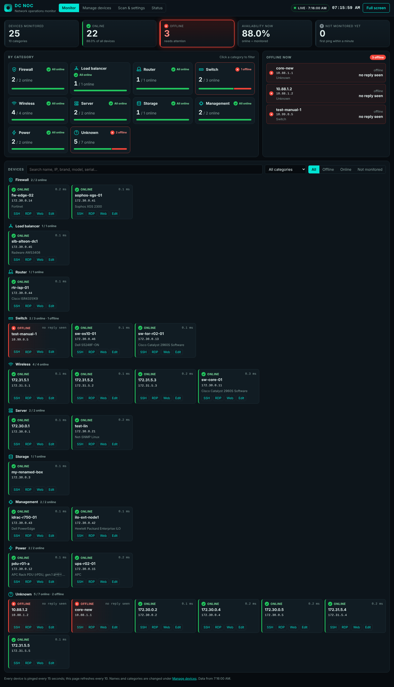
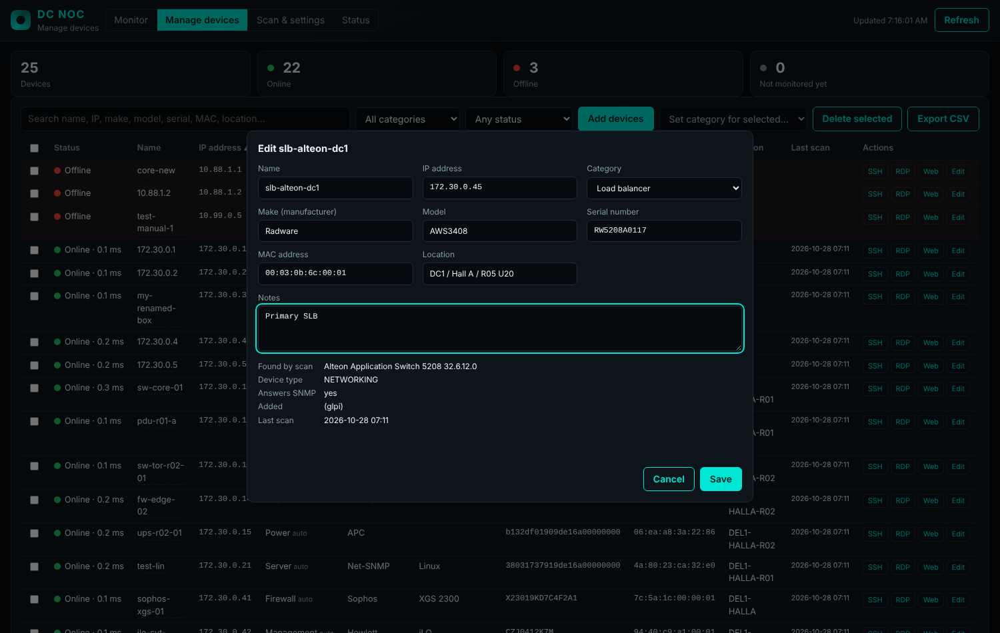
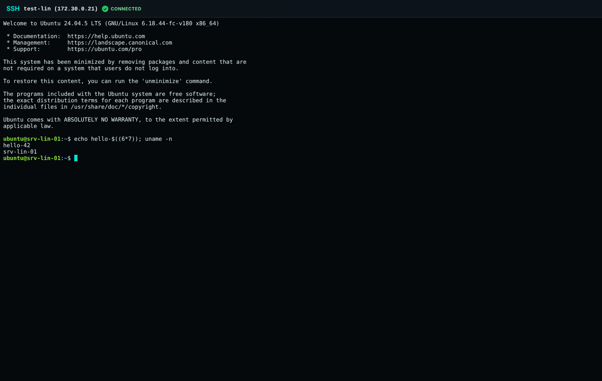

# DC NOC: offline data centre monitoring

Network monitoring for your data centre on **one Linux server with no internet connection**. It scans your networks, keeps a device list (name, category, make, model, serial number, MAC, location, notes), shows every device **online / offline by category** (Firewall, Load balancer, Router, Switch, Server, Storage …), and opens **SSH in a browser tab**, Remote Desktop or the device's web page in one click. No sign-in: keep it on the management network.

**See [EQUIPMENT.md](EQUIPMENT.md)** for what to enable on Sophos, Radware Alteon, HPE SimpliVity / VM Essentials, Accesleron, HP/Dell servers and Cisco/Dell/HP switches and routers. **Step-by-step deployment: [DEPLOYMENT-GUIDE.md](../DEPLOYMENT-GUIDE.md).**

Addresses below are for the default **HTTPS mode** (`TLS=yes` in `.env`). In HTTP mode everything is on `http://<server>:8080/`.

| Page | URL | What it does |
|---|---|---|
| **Monitor** | `https://<server>/` (or `:8443/viewer/`) | Live online/offline counts and availability, a card per **category** with its health, an **Offline now** list with how long, and every device as a tile with **SSH / RDP / Web / Edit**. Pinged every 15 s, page refreshes every 10 s, full screen for wall displays |
| **Manage devices** | `…/viewer/devices.html` | Table of all devices with status. **Edit** a device (name, IP, category, make, model, serial, MAC, location, notes), **Add devices** by IP, set categories or delete in bulk, export CSV |
| **Scan & settings** | `…/viewer/scan.html` | Networks to scan, SNMP credentials, scan interval, **Scan now** with progress, *Find networks from a router*, feature switches, saved SSH host keys |
| **SSH** | `…/viewer/ssh.html?host=<ip>` | A terminal in a browser tab (opened by the SSH buttons); the DC server connects to the device for you |
| **Status** (Grafana) | `…/viewer/status.html`, `…:8443/grafana/` | Up/down history and availability by category, ports, traffic, errors, CPU, firewall HA, server hardware health. Switch the tab on under *Features* |
| Learning library | `…:8443/glpi-datacenter-library.html` | NehraEduHub data centre course, works offline |

```
                     ┌──────────────── your offline server (Docker) ─────────────────┐
 browser ──HTTPS──►  │ portal (nginx) ── /viewer/  Monitor, Manage, Scan, SSH pages   │
                     │   ├─ /api/ ──► manager: device list (devices.json), settings,  │──SSH──► devices
                     │   │            status, scan now, browser SSH                   │
                     │   └─ /grafana/ ──► grafana ◄── prometheus ◄── blackbox (ping) ─┼──ICMP─► every device
                     │                                     ▲   └── snmp-exporter ─────┼──SNMP─► network devices
                     │ collector: scans networks ──► manager (device list)            │──SNMP─► your networks
                     │ monitor-sync: device list ──► Prometheus targets               │
                     └────────────────────────────────────────────────────────────────┘
```



## 1. Build the bundle (on a machine with internet)

```bash
./scripts/prepare-offline-bundle.sh                         # server runs Ubuntu 24.04 (default)
SERVER_OS=ubuntu:22.04 ./scripts/prepare-offline-bundle.sh  # or debian:12, rockylinux:9, almalinux:9
SERVER_OS=none ./scripts/prepare-offline-bundle.sh          # Docker already on the server
```

It pulls the images (nginx, Grafana, Prometheus, Blackbox and SNMP exporters), builds the scanner image `dc-collector` (GLPI Agent network tools, Perl), downloads Docker Engine packages for the server's OS, and writes `dc-offline-bundle-<date>.tar.gz` with checksums. Copy it to the server (USB, internal share).

## 2. Install on the offline server

```bash
sudo mkdir -p /opt/dc && sudo tar -xzf dc-offline-bundle-YYYYMMDD.tar.gz -C /opt/dc
cd /opt/dc/dc-offline-bundle-YYYYMMDD
sudo ./site/datacenter-offline/scripts/preflight.sh     # checks only
sudo ./install-offline.sh                               # SERVER_NAME=dc.example.lan to name the certificate
sudo ./site/datacenter-offline/scripts/verify.sh        # end-to-end check
```

The installer installs Docker from the bundle if needed, loads the images, creates `.env`, an HTTPS certificate (self-signed, or put yours in `tls/`) and starts everything. If ports 80/443 are taken, set `HTTPS_PORT` and `HTTP_REDIRECT_PORT` in `.env` and run it again (the installer stops with a clear message first).

**Upgrading** from a version that used GLPI: run the installer of the new version (or `tools/update-from-github.sh`). It copies the device list out of GLPI (names, make, model, serial, MAC and the categories you set), then removes the GLPI and MariaDB containers. Their data stays in the volumes `dc_glpi_data` and `dc_db_data` until you run `docker volume rm dc_glpi_data dc_db_data`.

**Updating from GitHub** (server with access to github.com): `sudo bash /opt/dc/dc-kit-git/tools/update-from-github.sh` pulls, saves the current kit, copies the new one over it and re-runs the installer. Your `.env`, `collector.conf`, keys, certificates and device list are kept.

## 3. Scan your networks

1. Open **Scan & settings**.
2. **Networks to scan**: add each network (`192.168.15.0/24`), a range (`192.168.15.10-192.168.15.50`) or one IP, up to /16. *Find networks from a router* reads a router's interfaces and routing table over SNMP and lists what it knows.
3. **SNMP credentials**: a read-only v2c community or SNMPv3 user (SHA/MD5, AES/DES). Tried in order on every address.
4. **Save changes**, then **Scan now**. Each /24 takes about 1–2 minutes; then it runs every *Scan every* minutes.

What a scan finds goes into the device list:

- Devices that answer **SNMP**: name (sysName), make, model, serial number, MAC, firmware, location, and a **category** worked out from make and model (Sophos/Fortinet → Firewall, Radware Alteon → Load balancer, Cisco ISR → Router, iLO/iDRAC → Management, APC → Power, …).
- Devices that only answer ping: their IP (and MAC on the server's own networks), category *Unknown*. Edit them to fill in the rest.
- A device seen at two addresses with the same serial number is kept once (the other address is noted).
- **What you edit is kept**: a scan only fills in fields you have not changed. Set a category back to *Automatic* to let scans decide again.

**Servers over SSH/WinRM and VMware** (hardware, OS, serial numbers) are optional: list them in `collector/collector.conf` (`REMOTES`, `ESX_HOSTS`) and switch on *Collect servers* / *Collect VMware* under Features. Windows needs a local account with WinRM Basic login (EQUIPMENT.md); `scripts/test-remote.sh <ip>` says why a login fails. Networks and credentials in `collector.conf` (`SNMP_RANGES`, `SNMP_CREDENTIALS`) are used together with the ones from the browser.

```bash
cd /opt/dc/dc-offline-bundle-YYYYMMDD/site/datacenter-offline
docker compose exec collector collect.sh once    # scan now from the command line
docker compose logs -f collector                 # watch progress
```

## 4. Monitor, edit, connect

- **Monitor**: KPI tiles (monitored, online, offline, availability, not monitored yet), category cards (click one to filter), **Offline now** with how long, and device tiles grouped by category. The browser tab title shows "(3 DOWN)" and a message pops up when a device goes offline.
- **Manage devices → Edit**: change name, IP, category, make (with suggestions), model, serial, MAC, location and notes. The status and Grafana pick up a change within seconds.
- **SSH** opens a terminal in a new tab: log in with the device's own user and password. The first connection shows the device's key fingerprint and remembers it; if the key ever changes, the connection is refused (remove the old key under *Scan & settings → SSH host keys* once you know why). Only devices in the list can be reached. Passwords are never stored.




- **RDP** downloads a `.rdp` file that opens Remote Desktop (mstsc). **Web** opens `https://<ip>/`.

## 5. Status dashboards (Grafana)

Switch on *Status tab (Grafana)* under Features. Dashboards open without a login (`GRAFANA_ANONYMOUS=true`); the Grafana admin password is `GRAFANA_ADMIN_PASSWORD` in `.env`.


**Device status**: devices monitored / up / down, availability last 24 h, devices down now with how long, up/down history, all devices with ping time and availability, slowest devices. The **Type** filter is the device category.


**Network & hardware**: devices that answered SNMP in a scan, and firewalls, load balancers, routers, switches, storage, management cards and power devices, are polled over SNMP every minute with the first credential that works. The vendor is read from sysObjectID for its health metrics: **Sophos** (HA state, memory, disk, swap, live users), **Cisco** (CPU), **HPE iLO** (power supplies, temperatures, drives), **Dell iDRAC** (global and storage status, temperatures), **Dell OS10** (CPU, power supplies). Shows ports down, port errors, traffic, busiest ports, CPU, hottest sensor per server and components not OK.

**Checks beyond ping** go in `monitoring/manual/*.yml` (picked up within a minute; see `example.yml.disabled` and `your-services.yml.disabled`):

```yaml
- targets: ["10.10.1.21:22"]
  labels: { module: ssh_banner, name: "SRV-WEB-01 SSH", type: Service }
- targets: ["https://10.10.0.5"]
  labels: { module: http_2xx, name: "Core switch web UI", type: Service }
```

Modules: `icmp`, `tcp_connect`, `http_2xx`, `ssh_banner` (more in `monitoring/blackbox/blackbox.yml`).

| `.env` setting | Default | Meaning |
|---|---|---|
| `GRAFANA_ANONYMOUS` | `true` | Dashboards without logging in |
| `MONITOR_SYNC_MINUTES` | `5` | Device list → monitoring re-read (changes in the browser apply at once) |
| `PROMETHEUS_RETENTION` | `90d` | How long to keep history |

## 6. Backup and restore

```bash
sudo ./scripts/backup.sh       # device list, settings, SSH host keys, .env, collector.conf, certificate
```

Schedule it daily (`/etc/cron.d/dc-backup`: `30 2 * * * root /opt/dc/<bundle>/site/datacenter-offline/scripts/backup.sh`). Restore onto a fresh install:

```bash
docker compose exec -T manager tar -C /settings -xzf - < backups/<ts>/dc-settings.tar.gz
tar -xzf backups/<ts>/kit-config.tar.gz
docker compose restart
```

## 7. Security checklist

- [ ] There is **no sign-in**: anyone who can open the portal can edit devices, change settings and open SSH sessions (with the device's own password). Allow ports 80/443/8443 (or yours) only from admin and NOC networks on the server firewall
- [ ] HTTPS on (`TLS=yes`) with a certificate from your internal CA in `tls/server.crt` / `tls/server.key`
- [ ] Read-only SNMP credentials (SNMPv3 where possible), restricted to the server's IP on the devices
- [ ] `collector/collector.conf` stays `chmod 600`; SNMP credentials entered in the browser are stored in the `dc_settings` volume
- [ ] SSH host keys: check the fingerprint on first connection; never remove a changed key without knowing why

## Files

| Path | What |
|---|---|
| `docker-compose.yml`, `docker-compose.tls.yml` | The stack (portal, manager, collector, monitor-sync, Prometheus, Blackbox, SNMP exporter, Grafana) and HTTPS ports |
| `manager/manager.pl` | API behind `/api/`: device list (`devices.json` in the `dc_settings` volume), settings, status, scan now, browser SSH |
| `collector/` | Scanner image (`Dockerfile`), `collect.sh` (schedule), `to-devices.pl` (scan results → device list), `settings-env.pl`, `collector.conf.example` |
| `monitoring/` | Prometheus, Blackbox, Grafana provisioning and dashboards, `targets/monitor-sync.pl` (device list → targets), `manual/` extra checks |
| `viewer/` | Monitor (`index.html`), Manage devices, Scan & settings, SSH (xterm.js in `vendor/`, MIT), Status; plain HTML/JS/CSS, no external libraries |
| `nginx/` | Portal configuration (HTTP and HTTPS) |
| `scripts/` | `install-offline.sh`, `preflight.sh`, `verify.sh`, `backup.sh`, `prepare-offline-bundle.sh`, `download-docker-packages.sh`, `discover-networks.sh`, `test-remote.sh`, `patch-collector.sh`, `migrate-from-glpi.pl` |
