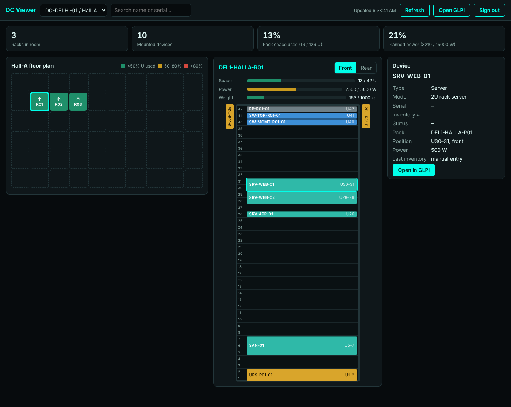

# Offline Data Centre Kit (GLPI)

Run GLPI on your own server with **no internet connection**. You get a GUI to see your data centre and tools to bring your devices into it.

| What | URL on your server | Used for |
|---|---|---|
| **GLPI** | `http://<server>/` | Main GUI: data centres, server rooms, racks, assets, cables, tickets, contracts |
| **DC Viewer** | `http://<server>:8080/viewer/` | Read-only screen for the NOC or a wall display: floor plan, rack fronts and backs, space/power/weight, device search |
| **Learning library** | `http://<server>:8080/glpi-datacenter-library.html` | NehraEduHub GLPI data centre course, works offline |

```
                    ┌────────────── your offline server (Docker) ──────────────┐
 browser ──:80────► │ glpi   (GLPI 11, Apache, cron)  ◄──── inventory ◄────────┼──── GLPI Agent on servers
                    │   │                                                       │
 browser ──:8080──► │ portal (nginx) ── /apirest.php ──► glpi                   │      SNMP scan
                    │   ├─ /viewer/   DC Viewer                                 │ ◄─── switches, PDUs, UPS,
                    │   └─ library pages                                        │      firewalls, storage
                    │ db     (MariaDB 11.4)                                     │
                    └───────────────────────────────────────────────────────────┘
```

---

## 1. Build the bundle (on a machine with internet)

Requires Docker and `curl`. Run it from this repository:

```bash
./datacenter-offline/scripts/prepare-offline-bundle.sh
# pin the agent version if GitHub's API is blocked for you:
AGENT_VERSION=1.17 ./datacenter-offline/scripts/prepare-offline-bundle.sh
```

This creates `dc-offline-bundle-YYYYMMDD.tar.gz` (about 500 MB). It contains:

- Docker images: `glpi/glpi:11.0.11`, `mariadb:11.4`, `nginx:1.27-alpine` (versions set in `.env.example`)
- GLPI Agent installers for Linux (`.pl`) and Windows (`.msi`)
- This kit, the website and the learning library
- `SHA256SUMS` so the server can check the copy wasn't corrupted

Copy the file to the server over USB or an internal share.

### Installing Docker offline

The server needs Docker Engine and the compose plugin. On an offline Ubuntu or Debian server, download these `.deb` files on the online machine from
`https://download.docker.com/linux/<ubuntu|debian>/dists/<codename>/pool/stable/amd64/`:
`containerd.io`, `docker-ce`, `docker-ce-cli`, `docker-buildx-plugin`, `docker-compose-plugin`.
Then on the server run `sudo dpkg -i ./*.deb`.
For RHEL, Rocky or Alma, use the `.rpm` files from `https://download.docker.com/linux/rhel/`.

## 2. Install on the offline server

```bash
tar -xzf dc-offline-bundle-YYYYMMDD.tar.gz
cd dc-offline-bundle-YYYYMMDD
sudo ./install-offline.sh
```

The installer:

1. checks the bundle files against `SHA256SUMS` and loads the Docker images (nothing is downloaded)
2. creates `.env` with a random database password
3. starts GLPI, MariaDB and the portal; on first start GLPI installs its database (1–3 minutes)
4. turns on GLPI inventory and the REST API, and allows API access from the Docker network
5. asks for a new password for the `glpi` super-admin and offers to disable the demo accounts `tech`, `normal` and `post-only`

Non-interactive: `sudo ADMIN_PASSWORD='…' DISABLE_DEMO_USERS=yes ./install-offline.sh`

Ports and versions are in `site/datacenter-offline/.env` (`GLPI_PORT`, `PORTAL_PORT`). After changing them, run `docker compose up -d` in that folder.

## 3. Build your data centre in GLPI

You can enter everything in the GLPI GUI. For many racks, use the CSV import:

1. Edit `layout/racks.csv`: data centre, server room, room grid size, rack name, height in U, grid column/row, which way it faces (N/E/S/W), max power (W), max weight (kg).
2. Edit `layout/devices.csv`: rack, device name, type, model, height in U, bottom U position, `front`/`rear` (or `left`/`right` for 0U PDUs), half-width side, power (W), weight (kg), **serial**.
3. Run the import on the server. It needs only Python 3, no extra packages:

```bash
cd site/datacenter-offline
python3 scripts/import_layout.py --url http://localhost --user glpi \
    --racks layout/racks.csv --devices layout/devices.csv --dry-run   # preview
python3 scripts/import_layout.py --url http://localhost --user glpi \
    --racks layout/racks.csv --devices layout/devices.csv
```

You can run the import again whenever the CSVs change. It matches objects by name, updates what changed and moves devices to their new U positions.

Device `type` values: `server`, `storage`, `switch`, `router`, `firewall`, `pdu`, `ups`, `enclosure`, `patchpanel`, `kvm`, or any GLPI itemtype (`Computer`, `NetworkEquipment`, `PDU`, `PassiveDCEquipment`, `Enclosure`, `Peripheral`, `Monitor`).

> **Fill in the serial number.** GLPI links agent and SNMP inventory to existing assets by **serial number / UUID**, not by name. If you import a server without its serial and its agent reports later, GLPI creates a second asset with the same name. With the serial in the CSV, the inventory updates the asset that is already in the rack.
>
> **Models and rack height.** Inventory sets the real model, for example `PowerEdge R750`. GLPI treats a new model as 1U until you size it. If you leave the CSV `model` column empty, the import sets `units`, `power_w` and `weight_kg` on whatever model the device already has. You can also set `model` to the exact name that inventory shows.

## 4. Connect your devices

### Servers: GLPI Agent

The agent sends hardware, OS, software, disks and network cards to GLPI, and repeats this on a schedule.

**Linux** (copy the `agents/` folder to each server):

```bash
sudo ./install-agent-linux.sh http://<glpi-server>/
```

**Windows** (as Administrator; the `.msi` must be next to the script):

```bat
install-agent-windows.cmd http://<glpi-server>/
```

For many Windows hosts, deploy the same `msiexec` command through GPO or SCCM:
`msiexec /i GLPI-Agent-<ver>-x64.msi /quiet SERVER="http://<glpi-server>/" RUNNOW=1 EXECMODE=1`

### Network, power and storage: SNMP

Switches, routers, firewalls, PDUs, UPS units and storage arrays are inventoried over SNMP from one Linux host that has the agent installed with network tasks. This is usually the GLPI server itself:

```bash
sudo ./agents/install-agent-linux.sh http://localhost/ --type=network
export SNMP_CREDENTIALS=$'version:2c,community:dc-readonly\nversion:3,username:glpi,authprotocol:sha,authpassword:XXX,privprotocol:aes,privpassword:YYY'
./scripts/snmp-discover.sh 10.10.0.1 10.10.0.254 http://localhost/
```

Use **read-only** SNMP communities or SNMPv3 users. Run it again after adding equipment, or schedule it with cron.

Then place the discovered devices in their racks: in the GLPI GUI (rack → **+** on a free U), or by adding them to `devices.csv` with the same name and running the import.

## 5. Using the DC Viewer



Open `http://<server>:8080/viewer/` and sign in with your GLPI account. Each user sees only what their GLPI profile allows.

- **Floor plan**: racks in their grid position. Colour shows how full each rack is, and the arrow shows which way it faces.
- **Rack**: front and rear views. Full-depth equipment mounted on the other side is shown hatched. Side PDUs appear beside the rack. Space, power and weight are shown against the rack's limits.
- **Search**: by name or serial. Matching racks and devices are outlined.
- **Open in GLPI** links take you to the full record. The view refreshes every 5 minutes (`viewer/config.js`).

For a wall screen, create a GLPI user with a read-only profile.

## 6. Backup and restore

```bash
./scripts/backup.sh                 # writes backups/<timestamp>/, keeps 14
```

Copy `backups/` off the server. It contains the database, the GLPI encryption key and `.env`, so keep it as protected as the server.

Restore onto a fresh install:

```bash
gunzip -c backups/<ts>/glpi-db.sql.gz | docker compose exec -T db sh -c 'mariadb -u"$MARIADB_USER" -p"$MARIADB_PASSWORD" "$MARIADB_DATABASE"'
docker compose exec -T glpi tar -C /var/glpi -xzf - < backups/<ts>/glpi-data.tar.gz
docker compose restart glpi
```

## 7. Security checklist

- [ ] `glpi` password changed and demo accounts disabled (the installer offers both)
- [ ] Server firewall allows ports 80/8080 only from admin and NOC networks
- [ ] HTTPS: put your internal CA certificate on a reverse proxy in front of ports 80 and 8080
- [ ] To use the import script from an admin PC, set `API_ADMIN_RANGE_START/END` in `.env`, then run `scripts/configure-glpi.sh`
- [ ] Read-only SNMP credentials only
- [ ] `backup.sh` scheduled, and backups copied off the server
- [ ] To update GLPI: build a new bundle with a newer `GLPI_VERSION`, run `backup.sh`, then `install-offline.sh` (GLPI updates its database automatically)

## Files

| Path | Purpose |
|---|---|
| `docker-compose.yml`, `.env.example` | The stack and its settings |
| `nginx/default.conf` | Portal: library, viewer, API proxy |
| `viewer/` | DC Viewer (plain HTML/JS/CSS, no external libraries) |
| `scripts/prepare-offline-bundle.sh` | Build the bundle (online machine) |
| `scripts/install-offline.sh` | Install from the bundle (offline server) |
| `scripts/configure-glpi.sh` | Turn on inventory and the API, allow API clients |
| `scripts/import_layout.py` | CSV → GLPI data centres, rooms, racks, devices |
| `scripts/snmp-discover.sh` | SNMP discovery and inventory → GLPI |
| `scripts/backup.sh` | Database and files backup |
| `agents/` | Agent install scripts for Linux and Windows |
| `layout/*.csv` | Example layout to edit |
| `docs/` | Screenshots |
